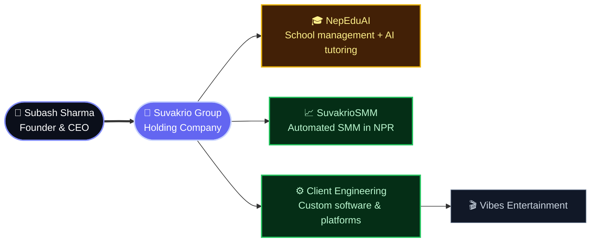

<a href="https://www.subashcode.dev">
  <picture>
    <source media="(prefers-color-scheme: dark)" srcset="https://readme-typing-svg.demolab.com?font=Fira+Code&weight=700&size=64&duration=2000&pause=99999&color=FFFFFF&center=true&vCenter=true&repeat=false&width=900&height=100&lines=Subash+Sharma" />
    <source media="(prefers-color-scheme: light)" srcset="https://readme-typing-svg.demolab.com?font=Fira+Code&weight=700&size=64&duration=2000&pause=99999&color=0B0F1A&center=true&vCenter=true&repeat=false&width=900&height=100&lines=Subash+Sharma" />
    
  </picture>
</a>

<picture>
  <source media="(prefers-color-scheme: dark)" srcset="https://readme-typing-svg.demolab.com?font=Fira+Code&weight=500&size=20&pause=1200&color=818CF8&center=true&vCenter=true&width=760&lines=Founder+%26+CEO+%40+Suvakrio+Group;19+y%2Fo+Full-Stack+Developer+from+Nepal;Building+the+companies+Nepal+couldn't+find;Strategy+%E2%86%92+Design+%E2%86%92+Code+%E2%86%92+Ship" />
  <source media="(prefers-color-scheme: light)" srcset="https://readme-typing-svg.demolab.com?font=Fira+Code&weight=500&size=20&pause=1200&color=4F46E5&center=true&vCenter=true&width=760&lines=Founder+%26+CEO+%40+Suvakrio+Group;19+y%2Fo+Full-Stack+Developer+from+Nepal;Building+the+companies+Nepal+couldn't+find;Strategy+%E2%86%92+Design+%E2%86%92+Code+%E2%86%92+Ship" />
  
</picture>

  

 

  

<table>
  <tr>
    <td>
      🔴 🟡 🟢 &nbsp;&nbsp;<code>subash@suvakrio:~</code>
       
      
    </td>
  </tr>
</table>

 

## ⚡ About

I'm a **19-year-old founder and full-stack developer from Nepal**. I lead **[Suvakrio Group](https://suvakrio.com/)**, a Nepali holding company building software, marketing and media ventures, registered under the Company Act 2063.

Our thesis is simple: **we build the companies we couldn't find.** I own the whole problem, from strategy and design to code and launch.

> [!TIP]
> **Open to partnerships, client work and ambitious ideas.** If you're building something real, [let's talk](mailto:ceo@suvakrio.com).

 

## 🏗️ The Suvakrio Ecosystem

 

## 🚀 Ventures

<table>
  <tr>
    <td width="50%" valign="top">
      <h3>🎓 NepEduAI</h3>
       
      
K-12 school management and AI tutoring built around Nepal's official curriculum and marking schemes, so students can learn and self-assess.

      <b>AI · Next.js · Python</b>
        
      
    </td>
    <td width="50%" valign="top">
      <h3>📈 SuvakrioSMM</h3>
       
      
Automated social-media marketing reseller platform for Nepal, covering TikTok, Instagram, YouTube, Facebook and Telegram, with native NPR payments through eSewa, Khalti, IME Pay and QR, real-time tracking and a reseller API.

      <b>Node.js · PostgreSQL · Payments</b>
        
      
    </td>
  </tr>
  <tr>
    <td width="50%" valign="top">
      <h3>⚙️ Client Engineering</h3>
       
      
Web platforms and multi-tenant software for outside partners. We only take on problems we've already proven we can solve.

      <b>Web · Cloud · ERP · Billing</b>
        
      
    </td>
    <td width="50%" valign="top">
      <h3>🎬 Vibes Entertainment</h3>
       
      
Led web development and IT infrastructure for the entertainment brand, running the digital side of a media operation.

      <b>Web · React · IT</b>
        
      
    </td>
  </tr>
</table>

 

## 🧭 How I Operate

<table>
  <tr>
    <td width="25%" valign="top" align="center">
      <h3>🚢</h3>
      <b>Built to ship</b>
       Launch something real and iterate, instead of polishing a plan that never leaves the deck.
    </td>
    <td width="25%" valign="top" align="center">
      <h3>🇳🇵</h3>
      <b>Local first</b>
       Every product starts from what the Nepali market actually needs, not a foreign template.
    </td>
    <td width="25%" valign="top" align="center">
      <h3>🧑‍💻</h3>
      <b>Founder-run</b>
       No management layer between the people who build and the people who use it.
    </td>
    <td width="25%" valign="top" align="center">
      <h3>🎯</h3>
      <b>One bar</b>
       Different products, one standard for what's good enough to put in front of a user.
    </td>
  </tr>
</table>

 

## 🛠️ Arsenal

 

  

<b>WHAT THE GROUP SHIPS</b>
 

  

<b>LEADERSHIP</b>
 

 

## 🏆 Recognition

 

 

 

<b>🎮 Off the clock (click to expand)</b>

 

- 🎮 Gamer at heart
- 🎨 Graphic design is my second language
- 🧩 Rubik's cube in **under a minute**
- 🎓 BCA student at Crimson College of Technology
- 🌱 Currently learning: how to chill (still failing)

 

<picture>
  <source media="(prefers-color-scheme: dark)" srcset="https://readme-typing-svg.demolab.com?font=Fira+Code&weight=600&size=22&pause=1500&color=818CF8&center=true&vCenter=true&width=700&lines=Got+a+project+in+mind%3F;Let's+build+something+people+actually+use." />
  <source media="(prefers-color-scheme: light)" srcset="https://readme-typing-svg.demolab.com?font=Fira+Code&weight=600&size=22&pause=1500&color=4F46E5&center=true&vCenter=true&width=700&lines=Got+a+project+in+mind%3F;Let's+build+something+people+actually+use." />
  
</picture>

 

  

<b>नेपालमै बनेको</b> · Made in Nepal 🏔️ · © Subash Sharma

